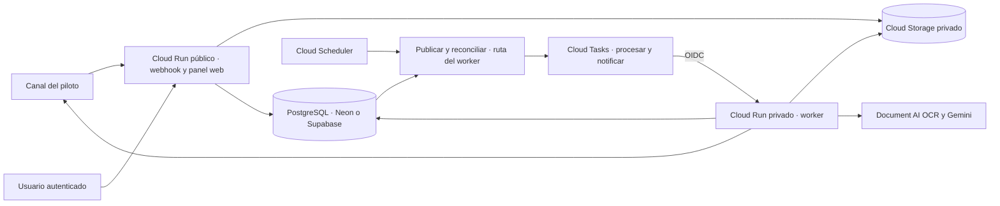
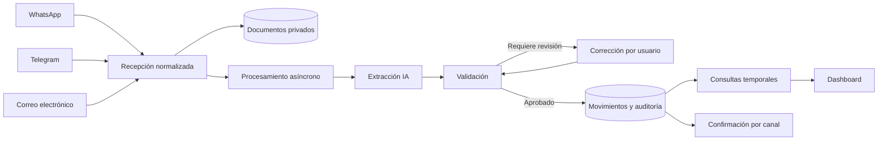

# Arquitectura y costos en GCP

Para el [piloto](PRD.md) se eligió la arquitectura híbrida **Cloud Run + Cloud Tasks + PostgreSQL administrado en plan gratuito**. Neon Free es la primera opción propuesta. Supabase Free es la alternativa si se decide usar su autenticación. Cloud SQL zonal queda como referencia de costo y opción de migración. Los movimientos, sus versiones y la auditoría comparten una transacción, y el tablero consulta el mismo historial.

## Opciones

| Opción | Componentes | Ventaja económica | Carga operativa y condición de uso |
|---|---|---|---|
| A. Serverless con Firestore | Cloud Run, Cloud Tasks, Cloud Storage y Firestore regional | Menor costo fijo y cobro por operaciones. | Pocas tareas de infraestructura. Más código para claves únicas, índices compuestos y agregados coherentes cuando cambia un movimiento. Útil si prima el desembolso y los filtros quedan acotados. |
| B. PostgreSQL zonal | Cloud Run, Cloud Tasks, Cloud Storage y Cloud SQL PostgreSQL Enterprise zonal | Base administrada con un costo mensual previsible. SQL simplifica consultas, correcciones y auditoría. | Administrar esquema, conexiones y respaldos. Instancia compartida para piloto con interrupciones aceptables, sin SLA para ese tipo de máquina. Dimensionar con pruebas de conexión y carga. |
| C. PostgreSQL regional con alta disponibilidad | Misma topología con Cloud SQL HA y CPU dedicada. | Reduce impacto de fallos zonales y conserva consultas y modelo de datos de B. | Mayor costo fijo. Ensayar reconexión y conmutación. Apropiada cuando el impacto comercial o los compromisos de recuperación justifican el gasto. |

La extracción, el canal y el modelo de autorización son comunes a las tres opciones. En A, usar transacciones Firestore y documentos con IDs deterministas para reservar claves de idempotencia y duplicidad. Aplicar correcciones con incrementos y decrementos atómicos sobre agregados diarios por comercio, moneda, tipo y categoría si las consultas directas exceden costo o latencia. Conciliar los agregados contra movimientos. En B y C, aplicar claves únicas por comercio y agregar sobre consultas indexadas antes de materializar resultados.

## Costos comparables en USD al mes

Precios de lista consultados el 18 de noviembre de 2026. Iowa (`us-central1`) es la referencia económica. Confirmar región y disponibilidad del extractor, latencia y tratamiento de datos antes de usar facturas reales. Esta es una estimación parcial reproducible para un ambiente, 730 horas, sin descuentos ni cuotas gratuitas.

| Escenario mensual | 1.000 documentos | 10.000 documentos | 100.000 documentos |
|---|---:|---:|---:|
| Procesamiento y almacenamiento comunes, sin extracción | 0,19 | 1,94 | 19,42 |
| A. Total con Firestore y Gemini | 2,68 + almacenamiento Firestore | 26,84 + almacenamiento Firestore | 268,42 + almacenamiento Firestore |
| B. Total con PostgreSQL zonal y Gemini | 12,03 | 36,06 | 276,29* |
| C. Total con PostgreSQL HA y Gemini | 93,61 | 117,63 | 357,86* |
| Extracción sola con Invoice Parser para todos los documentos | 100 | 1.000 | 10.000 |

\* Proyección con el mismo tamaño de base para mostrar sensibilidad. El número de documentos por sí solo no dimensiona la base. Validar capacidad a este volumen y sumar el cambio de instancia o almacenamiento que corresponda.

- **Comunes.** Por documento, 5 segundos acumulados de instancia facturable en Cloud Run, 1 vCPU y 0,5 GiB, 5 solicitudes, 4 operaciones Cloud Tasks de hasta 32 KB, 1 escritura y 2 lecturas de objetos. Original medio de 1 MiB, 3 meses de retención en régimen estable. Aproximación por documento de USD 0,000194244. Medir tráfico interactivo, cold starts y reintentos durante el piloto. [Cloud Run](https://cloud.google.com/run/pricing), [Cloud Tasks](https://cloud.google.com/tasks/pricing), [Cloud Storage](https://cloud.google.com/storage/pricing).
- **Base.** A supone 20 lecturas (incluidas las entradas facturables equivalentes) y 10 escrituras por documento, USD 0,000015 por documento. Añadir almacenamiento, índices, respaldos y PITR según medición. B usa db-f1-micro, 730 × 0,0105 más 10 GiB SSD × 0,17 = USD 9,37. C usa 1 vCPU y 2 GiB HA, 730 × (0,0826 + 2 × 0,014) más 30 GiB SSD HA × 0,34 = USD 90,94. [Firestore](https://cloud.google.com/firestore/pricing), [Cloud SQL](https://cloud.google.com/sql/pricing).
- **Extracción.** Escenario Gemini 3.1 Flash-Lite con tarifa no global ilustrativa, 3.000 tokens de entrada y 1.000 de salida facturable por documento. Costo = (3.000 × 0,275 + 1.000 × 1,65) ÷ 1.000.000 = USD 0,002475 por documento. Verificar soporte en la ubicación elegida y medir tokens con documentos reales. Invoice Parser cuesta USD 0,10 por documento de hasta 10 páginas. Si se aplica después de Gemini al 10 % de documentos, sumar USD 10, 100 o 1.000 según el volumen de la tabla. [Precios Gemini](https://cloud.google.com/model-garden/pricing), [Document AI](https://cloud.google.com/products/document-ai/pricing), [Procesadores Document AI](https://docs.cloud.google.com/document-ai/docs/processors-list).
- **Presupuesto completo.** Sumar almacenamiento de respaldos y recuperación puntual, entornos adicionales, identidad, observabilidad, secretos, salida de datos, impuestos, comisiones del canal y trabajo humano. A 10.000 documentos, cada 10 puntos porcentuales adicionales de revisión a 2 minutos por caso equivalen a 33,3 horas al mes. Comparar costo por documento correctamente registrado y tiempo activo de revisión usando la misma muestra para los extractores.

## Alternativas híbridas con PostgreSQL administrado

Mantener webhook, dashboard, worker, cola, originales y extracción en GCP. Cambiar únicamente el proveedor de PostgreSQL. Supabase también puede encargarse de la identidad web si simplifica el desarrollo. Si se elige esa opción, Cloud Run verifica el token y aplica los permisos por comercio. Mantener la base detrás de la API y guardar credenciales en Secret Manager.

| Base de datos | Precio de base mensual | Total parcial a 1.000 docs | Total parcial a 10.000 docs |
|---|---:|---:|---:|
| Neon Free | 0 dentro de 100 CU-h y 1 GB de datos por proyecto | 2,67 | 26,69 |
| Supabase Free | 0 dentro de 500 MB | 2,67 | 26,69 |
| Neon Launch, ejemplo con 50 CU-h y 1 GB | 5,65 por cómputo y datos | 8,32 | 32,34 |
| Cloud SQL zonal del modelo | 9,37 | 12,03 | 36,06 |
| Supabase Pro | Desde 25 | Desde 27,67 | Desde 51,69 |

USD al mes usando el costo no redondeado de procesamiento común más Gemini de la tabla anterior. La fila Launch es una simulación, no una previsión del consumo ni una cotización. El proveedor publica USD 15/mes como gasto típico para una carga intermitente con 1 GB. Confirmar cargos mínimos aplicables y sumar historial de restauración, respaldos y transferencia entre proveedores. [Planes y tarifas de Neon](https://neon.com/pricing), [planes de Supabase](https://supabase.com/pricing), [Cloud SQL](https://cloud.google.com/sql/pricing).

- **Neon Free para validar el piloto al menor costo.** El cómputo se suspende tras 5 minutos inactivo y se reactiva al conectar. Medir latencia de reactivación y CU-h por semana. Verificar si las comprobaciones periódicas del reconciliador mantienen la base activa. Ajustar el intervalo o el mecanismo de reconciliación solo si se conserva el objetivo de latencia y recuperación del piloto. [Neon](https://neon.com/pricing).
- **Supabase Free si se aprovechará Auth.** El proyecto puede pausarse por baja actividad durante una semana y Free carece de respaldos automáticos. Para facturas reales, definir respaldo lógico independiente y probar restauración antes de aceptar el riesgo. Pro incluye respaldos diarios de siete días. [Pausas](https://supabase.com/docs/guides/platform/free-project-pausing), [respaldos](https://supabase.com/docs/guides/platform/backups).
- **Punto de equilibrio.** A 1 GB, Neon Launch alcanza los USD 9,37 del Cloud SQL de referencia cerca de 85 CU-h al mes antes de cargos adicionales. Si la base será consultada continuamente, comparar el consumo medido con Cloud SQL. Supabase Pro cuesta más si solo se compra PostgreSQL. Evaluar su valor conjunto si también sustituye identidad y herramientas de administración.
- **Integración y salida.** Probar TLS con verificación de certificado, latencia desde Cloud Run, reintento con conexiones nuevas, presupuesto de conexiones y restauración. Para Supabase usar el pooler adecuado al driver, con modo sesión o conexión directa para migraciones. Conservar migraciones de PostgreSQL portables y medir el cambio de proveedor en un entorno de pruebas. Confirmar región, acceso desde GCP y tratamiento de datos con ambos proveedores antes de recibir facturas reales. [Conexiones a Supabase](https://supabase.com/docs/guides/database/connecting-to-postgres).

## OCR y extracción del piloto

| Entrada | Lectura | Extracción |
|---|---|---|
| PDF digital con texto utilizable | El worker obtiene la capa de texto del PDF. | Gemini 3.1 Flash-Lite convierte el contenido en campos JSON. Puede recibir el PDF si la disposición visual es necesaria. |
| Foto JPEG/PNG o PDF escaneado | **Google Cloud Document AI Enterprise Document OCR** lee el texto y su posición en la página. | Gemini 3.1 Flash-Lite recibe el texto extraído y devuelve campos JSON. Evaluar en la muestra si necesita también la imagen para interpretar líneas complejas. |

Cloud Run valida fecha, moneda, total, etiqueta y duplicados. Los campos ausentes o ambiguos quedan explícitamente pendientes. Si la imagen es ilegible, solicitar otra captura. Guardar en PostgreSQL los campos y su auditoría, con el original en Cloud Storage. Registrar páginas procesadas, tokens y correcciones para comparar el costo y la precisión por formato.

La estimación híbrida anterior incluye Gemini. Añadir el OCR según el número de páginas de fotos y escaneos. Google publica las primeras 1.000 páginas sin cargo y USD 1,50 por cada 1.000 páginas adicionales en el primer tramo de pago. Invoice Parser queda como referencia para comparar precisión en la muestra. [Enterprise Document OCR](https://docs.cloud.google.com/document-ai/docs/enterprise-document-ocr), [Precios de Document AI](https://cloud.google.com/products/document-ai/pricing), [Gemini 3.1 Flash-Lite](https://docs.cloud.google.com/gemini-enterprise-agent-platform/models/gemini/3-1-flash-lite).

## Despliegue recomendado

Un repositorio y una imagen con dos configuraciones de Cloud Run, API y worker. El worker aloja las rutas de despacho y reconciliación autenticadas por IAM. Identity Platform autentica usuarios web. El servidor comprueba membresía y rol por comercio. Secret Manager guarda credenciales del canal. Usar cuentas de servicio distintas por función, límites de instancias, pools pequeños y una cola con concurrencia ajustada a las cuotas del extractor.

La API guarda original y transacción de recepción con trabajo pendiente antes del acuse de negocio. La publicación inmediata puede fallar tras el commit. Cloud Scheduler activa la reconciliación periódica, que republica trabajos pendientes o con lease vencido. La cola transporta identificadores y el worker reclama trabajos con lease y transiciones condicionales. Una tarea repetida consulta el estado antes de volver a aplicar efectos. Los avisos tienen registro y reintentos propios. Una entrega externa ambigua puede repetir un aviso si el proveedor carece de idempotencia.

## Operación y evolución

- **Antes del piloto.** Acordar retención de originales, extracciones, auditoría y backups. Separar proyectos de pruebas y producción. Verificar recuperación en un entorno aislado y medir RPO/RTO. Para cotizar B, usar como objetivos iniciales RPO de 24 h y RTO de 4 h, pendientes de aprobación y prueba.
- **Durante el piloto.** Alertar por edad del pendiente más antiguo, trabajos agotados, porcentaje de revisión, conexiones de base y costo proyectado. Etiquetar gastos por entorno y limitar tamaño, frecuencia y reintentos por comercio. Los presupuestos de facturación son alertas. Implementar cuotas en aplicación para limitar consumo.
- **Paso de B a C.** Habilitar HA cuando el objetivo de recuperación, la indisponibilidad observada o los compromisos del servicio lo requieran. Verificar recuperación zonal por separado de la restauración ante borrado o corrupción.
- **Capacidad.** Medir latencia p95 de dashboard, CPU, conexiones y tamaño de cola. Si las consultas incumplen los objetivos de forma sostenida, revisar planes e índices y considerar agregados diarios. Introducir analítica separada cuando las consultas exploratorias compitan con la carga transaccional.

[Ver flujos y diseño de pantallas](GRAFICOS.md).

## Componentes y flujo

| Componente | Función |
|---|---|
| WhatsApp | Verificar autenticidad del evento, recuperar adjunto y etiqueta, resolver identidad vinculada y enviar avisos por el mismo canal. |
| Telegram | Validar origen del evento del bot, recuperar archivo y texto, resolver usuario vinculado y devolver el estado al chat autorizado. |
| Correo electrónico | Validar el origen del evento de recepción y la identidad vinculada, interpretar asunto o cuerpo, recuperar adjuntos MIME y responder al remitente autorizado. |
| Recepción | Autorizar usuario y comercio, comprobar tipo real, tamaño y legibilidad básica del archivo, guardar el original y registrar el trabajo pendiente. |
| Núcleo | Coordinar extracción, clasificación, validación, revisión y registro con reglas comunes a los canales. |
| Dashboard | Consultar y presentar compras y ventas vigentes, historial, filtros y enlace autorizado al original. |

## Contratos y reglas de procesamiento

- Cada adaptador produce un evento con versión, comercio y usuario resueltos por vinculación autorizada, canal y cuenta receptora, identificador externo, identificador por adjunto, etiqueta, fecha de recepción y referencia privada al archivo. Para quien opera varios comercios, resolver explícitamente el destino antes de procesar.
- La interfaz de extracción recibe un original autorizado y devuelve campos estructurados, datos faltantes explícitos, líneas, categoría sugerida, evidencia por campo cuando exista y versión del extractor. La confianza orienta la revisión. El núcleo conserva la autoridad de aprobar y registrar.
- La validación exige comercio, tipo, fecha, moneda y total. Contrasta el tipo sugerido con la etiqueta, valida importes y aritmética cuando hay detalle suficiente y aplica tolerancias de redondeo acordadas. Envía a revisión los campos dudosos, etiquetas ausentes o contradictorias y posibles duplicados.
- La revisión muestra original y campos pendientes a un usuario autorizado. Una corrección registra actor, fecha y valores anteriores y vuelve a validar. Las correcciones y anulaciones posteriores conservan versiones y actualizan la vista vigente.
- Estados del documento: recibido, en procesamiento, en validación, requiere revisión, registrado, duplicado y fallido. Los fallos recuperables tienen reintentos acotados con espera progresiva. Los agotados quedan visibles para diagnóstico y reproceso.

## Persistencia y recuperación

- Usar una base relacional para comercios, usuarios, vínculos de canal, documentos, extracciones, movimientos, líneas, categorías, historial de estados y auditoría. Cada entidad comercial queda vinculada a su comercio. Usar importes decimales y conservar moneda original. Guardar archivos en almacenamiento privado con acceso temporal autorizado.
- Confirmar recepción tras conservar el original y registrar el procesamiento pendiente. Usar una clave de idempotencia por cuenta de canal, mensaje y adjunto. Detectar reenvíos entre canales por huella del archivo y contrastar coincidencias por comercio, emisor y número de comprobante. Enviar coincidencias ambiguas a revisión.
- Guardar movimiento, auditoría y aviso pendiente en una transacción de base de datos, con restricción de unicidad por documento y controles concurrentes sobre la identidad del comprobante cuando sea concluyente. El envío del aviso se reintenta por separado. Reconciliar archivos huérfanos y trabajos pendientes tras interrupciones.
- Aplicar autorización por comercio en recepción, revisión, historial, descarga y consultas. Proteger archivos y datos sensibles en tránsito y en reposo. Acordar retención, eliminación, acceso de soporte y recuperación de respaldos antes del piloto.

## Consultas temporales

Agrupar por fecha de operación y zona horaria del comercio en día, semana o mes. Ofrecer rango de fechas, categoría, tipo y comparación de períodos. Mostrar series paralelas de compras y ventas con el mismo eje temporal, incluyendo períodos sin movimientos. Calcular cantidades y totales por moneda original, con diferencia operativa cuando las monedas coincidan. Usar los mismos filtros y reglas de vigencia en dashboard e historial. Comenzar con consultas indexadas por comercio y fecha. Evaluar agregados persistidos si las mediciones del piloto lo justifican.

## Decisiones propuestas

| Decisión | Propuesta y criterio |
|---|---|
| Despliegue | Un monolito modular con API pública y worker privado, desplegados desde la misma imagen. |
| Canal del piloto | Habilitar primero el canal que el equipo acuerde con los comercios. Validar los otros dos mediante el mismo contrato antes de extender el piloto. |
| Extracción | Comparar precisión por campo, costo, latencia y tratamiento de datos con una muestra autorizada. Mantener reemplazable el proveedor. |
| Aprobación | Acordar campos, umbrales y tolerancias con datos de piloto. Enviar a revisión los casos que incumplan las reglas. |
| Métricas temporales | Validar con el equipo inicio de semana, comparación de rangos y presentación por moneda. Definir tratamiento de devoluciones y notas crédito. |

## Fases

| Fase | Resultado verificable |
|---|---|
| 0. Descubrimiento | Equipo valida flujo, canal, tipos documentales, muestra, política de aprobación y métricas del piloto. |
| 1. Captura y procesamiento | El canal elegido entrega una factura al núcleo y una repetición del evento produce un único resultado. |
| 2. Revisión y registro | Casos correctos, ilegibles, ambiguos y duplicados terminan en el estado esperado con trazabilidad. |
| 3. Dashboard | Compras y ventas coinciden con el historial para los mismos rangos, monedas y categorías. |
| 4. Piloto y extensión | Medir precisión, latencia y correcciones. Verificar los adaptadores restantes contra el contrato común. |

## Riesgos

| Riesgo | Tratamiento |
|---|---|
| Fotos borrosas o formatos heterogéneos | Muestra representativa, evidencia por campo y revisión asistida. |
| Registro doble por reenvío o concurrencia | Idempotencia de entrada, detección entre canales y pruebas de concurrencia. |
| Exposición de documentos entre comercios | Autorización en cada acceso, almacenamiento privado y pruebas cruzadas. |
| Caídas y límites de canales o proveedores | Trabajo durable, alertas de retraso, reintentos y reproceso con trazabilidad. |
| Totales engañosos por moneda, fecha o anulaciones | Agrupar por moneda, adoptar fecha de operación y cruzar reportes con historial vigente. |
| Costo y latencia de IA variables | Medir por documento y canal durante el piloto, incluyendo reintentos. |

