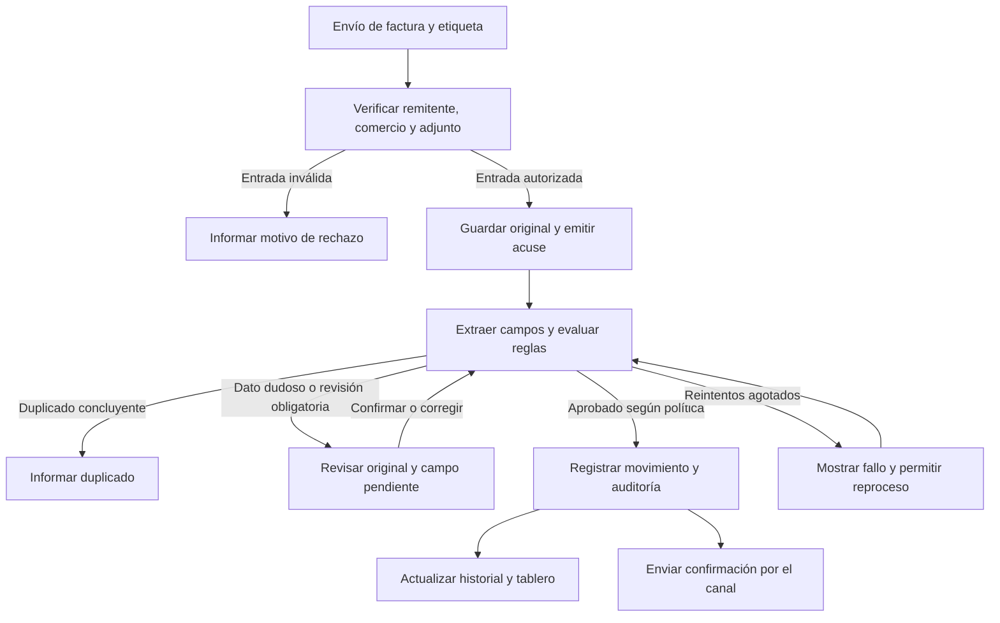
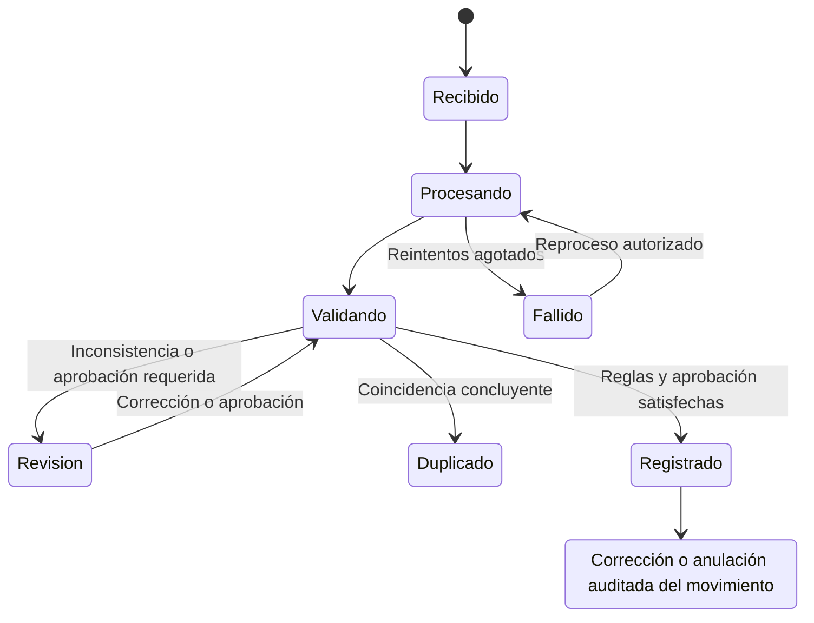

# Flujos y diseño de producto

## De la factura al tablero

## Estado del documento

Las correcciones y anulaciones posteriores versionan el movimiento, conservan el estado histórico del documento y actualizan sus indicadores vigentes.

## Pantallas del MVP

| Pantalla | Diseño y comportamiento |
|---|---|
| Resumen | Campos de fecha de inicio y de finalización arriba, junto a la moneda. El rango incluye ambos días y actualiza tarjetas, gráfica y detalle. Tarjetas de ventas, compras y diferencia operativa. Dos series sobre el mismo eje. El rango anterior se consulta con comparación y los períodos vacíos aparecen con cero. |
| Historial | Fecha, tipo, referencia, tercero, categoría, moneda, valor, estado y acceso al original. La vista filtrada usa las mismas reglas de vigencia que el resumen. |
| Bandeja de revisión | Pendientes ordenados por antigüedad. Cada fila indica motivo y estado. El operador ve sus documentos. Administración ve el comercio completo. |
| Detalle de revisión | Original y formulario lado a lado en escritorio, apilados en móvil. Resaltar campos dudosos con texto. Mostrar el motivo de una coincidencia y pedir confirmación antes de aplicar correcciones. |
| Configuración | Comercio, zona horaria y permisos. Vincular una identidad del canal a un usuario autenticado mediante código de un solo uso. |

Enlaces a detalle y originales requieren autorización del comercio. Colores y etiquetas de las series deben permitir distinguir compras y ventas sin depender del color.
